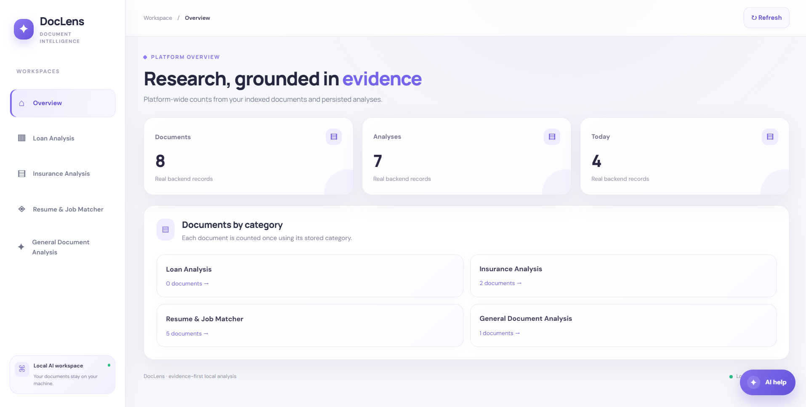
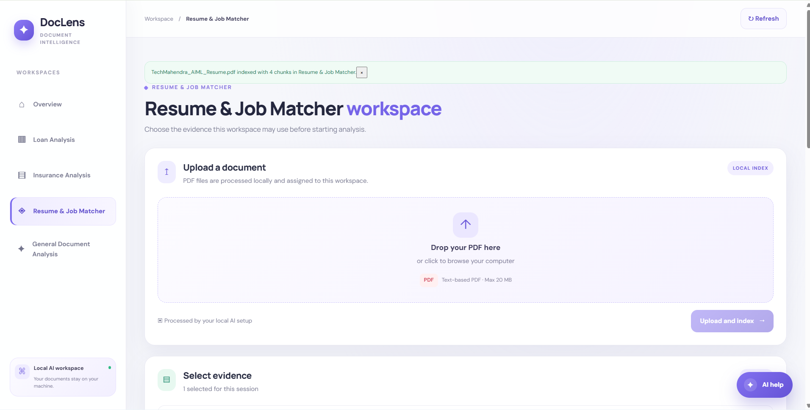
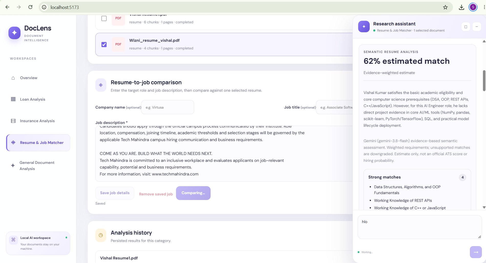

# DocLens — Agentic AI-Powered Document Intelligence

DocLens is an AI-powered document intelligence platform that turns static PDF documents into searchable, interactive sources of information. Users can upload documents, ask questions grounded in their contents, inspect supporting sources, and run specialized assessments for loan, insurance, and resume workflows.

The platform combines **Retrieval-Augmented Generation (RAG)**, semantic vector search, local language models, and Gemini-powered resume evaluation.

## Screenshots

### Platform overview


### Resume & Job Matcher workspace


### Resume-to-job match analysis


## Key capabilities

### 1. Document question answering with RAG
- Upload text-based PDF documents.
- Extract page text with PyMuPDF.
- Split extracted text into overlapping chunks.
- Generate embeddings locally with Ollama's `nomic-embed-text` model.
- Store document chunks, embeddings, and metadata in persistent ChromaDB.
- Convert user questions into embeddings and retrieve relevant chunks through semantic search.
- Generate document-grounded answers with Ollama's `llama3.2:3b` model.
- Return source references with document names, page numbers, and retrieved chunk IDs.

### 2. Document summaries
- Summarize selected documents using their indexed content.
- Preserve document/page source information in the generated response.
- Avoid presenting unsupported details as document facts.

### 3. Loan and insurance document assessment
- Analyze uploaded documents against user-configured criteria and exclusions.
- Return criterion-level outcomes such as **Matched**, **Not matched**, or **Insufficient evidence**.
- Include supporting document excerpts and source labels in the assessment prompt.
- Treat results as AI-assisted document assessments, not official approval, underwriting, or claim decisions.

### 4. Resume-to-job matching
- Compare a selected resume with a supplied job description.
- Use Google Gemini to produce structured, evidence-based requirement analysis.
- Classify requirements as matched, partial, or missing.
- Calculate a weighted estimated match percentage.
- Provide strengths, missing requirements, and recommendations.
- Validate that the uploaded document resembles a resume and that the job description contains actionable requirements.

### 5. Agent-assisted document search
- Use a bounded document-search workflow for questions.
- Retrieve relevant chunks from ChromaDB.
- Optionally perform a second search when the first retrieval returns too little context.
- Ground generated answers in retrieved document excerpts and cite source IDs.

### 6. Local-first document storage
- PDF files and ChromaDB index are stored in the backend's local `data/` directory.
- Ollama handles embeddings and document Q&A locally.
- Gemini is used by the resume-matching endpoint; its API key stays on the backend.

## Technology stack

| Area | Technology |
|---|---|
| Frontend | React, Vite, JavaScript |
| Backend | Python, FastAPI |
| PDF extraction | PyMuPDF (`fitz`) |
| Vector database | ChromaDB |
| Embeddings | Ollama — `nomic-embed-text` |
| Document Q&A model | Ollama — `llama3.2:3b` |
| Resume matching | Google Gemini API |
| API style | REST |

## RAG architecture

```text
PDF Upload
   |
   v
PyMuPDF text extraction (page-aware)
   |
   v
Chunking (900 characters, 150-character overlap)
   |
   v
Ollama embeddings (nomic-embed-text)
   |
   v
Persistent ChromaDB collection
   |
   |  User asks a question
   v
Question embedding
   |
   v
ChromaDB semantic retrieval (top-k relevant chunks)
   |
   v
Retrieved context + question + grounding instructions
   |
   v
Ollama chat model (llama3.2:3b)
   |
   v
Answer with document source references
```

**Note:** Resume matching is a separate Gemini-based workflow. Loan and insurance assessments currently send the selected document's indexed text and configured criteria to the LLM; they are document-grounded assessments but do not use the same semantic retrieval flow as `/api/chat`.

## Project structure

```text
DocLens/
├── backend/
│   ├── main.py
│   ├── .env.example
│   └── data/                 # Local PDFs, ChromaDB, history and configurations
├── frontend/
│   ├── public/
│   ├── src/
│   ├── package.json
│   └── vite.config.js
├── docs/
│   └── screenshots/
│       ├── overview-dashboard.png
│       ├── resume-workspace.png
│       └── resume-match-analysis.png
├── .gitignore
└── README.md
```

## Getting started

### Prerequisites

- Python 3.10 or later
- Node.js and npm
- Ollama installed and running
- Google Gemini API key for resume matching

### 1. Clone the repository

```bash
git clone https://github.com/vishal-debug310/DocLens.git
cd DocLens
```

### 2. Set up Ollama

Pull the models used by the backend:

```bash
ollama pull nomic-embed-text
ollama pull llama3.2:3b
```

Make sure the Ollama service is running locally at `http://localhost:11434`.

### 3. Configure and run the backend

```bash
cd backend
python -m venv .venv
```

Activate the environment on Windows:

```powershell
.venv\Scripts\activate
```

Install the backend dependencies:

```bash
pip install -r requirements.txt
```

Create `backend/.env` with your Gemini credentials:

```env
GEMINI_API_KEY=your_gemini_api_key
GEMINI_MODEL=gemini-2.5-flash
```

Start FastAPI from the `backend` directory:

```bash
uvicorn main:app --reload
```

The backend runs at `http://127.0.0.1:8000`.

Interactive API documentation is available at `http://127.0.0.1:8000/docs`.

### 4. Run the frontend

Open a second terminal:

```bash
cd frontend
npm install
npm run dev
```

Open the local URL printed by Vite (typically `http://localhost:5173`).

## Important API endpoints

| Endpoint | Purpose |
|---|---|
| `POST /api/upload` | Upload, extract, chunk, embed, and index a PDF |
| `GET /api/documents` | List indexed documents |
| `DELETE /api/documents/{document_id}` | Delete a document and its indexed chunks |
| `POST /api/chat` | Document-grounded question answering and summaries |
| `POST /api/agent-chat` | Bounded agent-assisted document retrieval and Q&A |
| `POST /api/evaluate-retrieval` | Inspect and evaluate retrieved chunks |
| `POST /api/document-analysis` | Loan or insurance document assessment |
| `POST /api/resume-match` | Gemini-based resume-to-job matching |
| `GET /api/overview` | Platform document and analysis metrics |
| `GET /api/health` | Check backend and Ollama availability |

## Configuration and data safety

- Keep `backend/.env` private and never commit API keys.
- Keep local PDFs, ChromaDB files, and analysis data out of Git.
- The uploaded PDF workflow currently supports text-based PDFs up to 20 MB. Scanned PDFs without selectable text require OCR, which is not implemented in the shown upload pipeline.
- Document analysis is decision support only. Loan eligibility and insurance outcomes must be verified by the relevant institution and must not be treated as final approval or rejection.

## Current implementation notes

- PDF text extraction is page-aware.
- Chunk size is configured to 900 characters with 150 characters of overlap.
- Semantic retrieval uses up to 8 chunks by default and filters results using a configured distance threshold.
- The agent chat endpoint limits execution to at most 3 steps.
- The Gemini API key is read by the backend and is not intended to be exposed to the frontend.

## Future improvements

- OCR support for scanned PDFs.
- More advanced retrieval evaluation and reranking.
- Stronger multi-document retrieval and conversational memory.
- More granular audit trails and explainability for assessments.
- Authentication, authorization, and per-user document isolation.
- Automated tests and deployment configuration.

## Author

**Vishal Kumar**  
GitHub: [@vishal-debug310](https://github.com/vishal-debug310)

---

<p align="center">
  Built with React, FastAPI, ChromaDB, Ollama, and Google Gemini.
</p>
